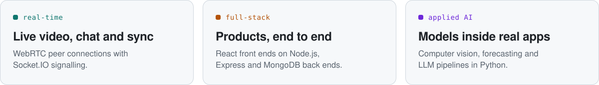
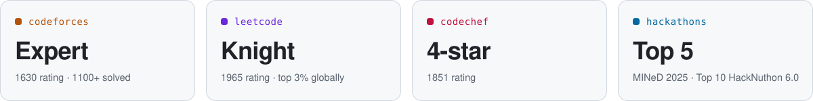
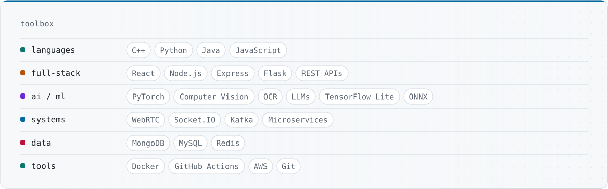

<a href="https://github.com/MeetAghara512">
  <picture>
    <source media="(prefers-color-scheme: dark)" srcset="assets/header-dark.svg">
    
  </picture>
</a>

<picture>
  <source media="(prefers-color-scheme: dark)" srcset="assets/focus-dark.svg">
  
</picture>

<picture>
  <source media="(prefers-color-scheme: dark)" srcset="assets/work-dark.svg">
  
</picture>

  

<a href="https://github.com/MeetAghara512/ShareThings">
  <picture>
    <source media="(prefers-color-scheme: dark)" srcset="assets/sharethings-dark.svg">
    
  </picture>
</a>

<a href="https://github.com/MeetAghara512/drivemyway"><picture><source media="(prefers-color-scheme: dark)" srcset="assets/drivemyway-dark.svg"></picture></a>
<a href="https://github.com/MeetAghara512/Insight-360-R"><picture><source media="(prefers-color-scheme: dark)" srcset="assets/insight-dark.svg"></picture></a>
<a href="https://github.com/MeetAghara512/KitchenSense-AI"><picture><source media="(prefers-color-scheme: dark)" srcset="assets/kitchensense-dark.svg"></picture></a>
<a href="https://github.com/MeetAghara512/Os-Scheduler-Simulator"><picture><source media="(prefers-color-scheme: dark)" srcset="assets/scheduler-dark.svg"></picture></a>

  

<picture>
  <source media="(prefers-color-scheme: dark)" srcset="assets/ranks-dark.svg">
  
</picture>

<picture>
  <source media="(prefers-color-scheme: dark)" srcset="assets/toolbox-dark.svg">
  
</picture>

  

<a href="https://www.linkedin.com/in/meetaghara512">LinkedIn</a> · <a href="https://codeforces.com/profile/meet.aghara522">Codeforces</a> · <a href="https://leetcode.com/u/meet_aghara522">LeetCode</a> · Live demos: <a href="https://sharethings-web.onrender.com">ShareThings</a>, <a href="https://drivemyway-web.onrender.com">drivemyway</a>

