<a href="https://www.linkedin.com/in/meetaghara512">LinkedIn</a> · <a href="https://codeforces.com/profile/meet.aghara522">Codeforces</a> · <a href="https://leetcode.com/u/meet_aghara522">LeetCode</a> ·
<a href="https://github.com/MeetAghara512/ShareThings">ShareThings</a> (<a href="https://sharethings-web.onrender.com">live</a>) · <a href="https://github.com/MeetAghara512/DriveMyWay">DriveMyWay</a> (<a href="https://drivemyway-web.onrender.com">live</a>) · <a href="https://github.com/MeetAghara512/Insight-360-R">Insight-360-R</a> · <a href="https://github.com/MeetAghara512/KitchenSense-AI">KitchenSense-AI</a> · <a href="https://github.com/MeetAghara512/Os-Scheduler-Simulator">CPU Scheduler</a>

