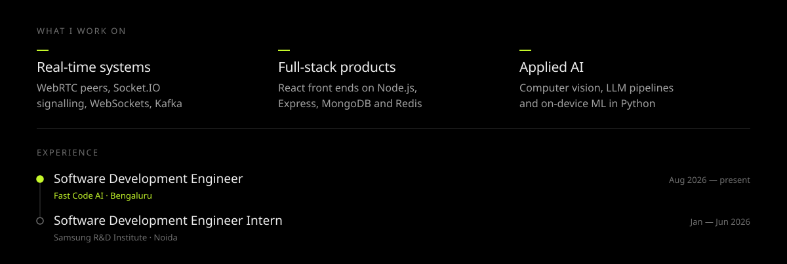
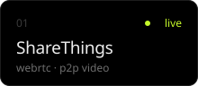
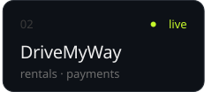
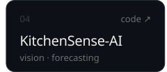
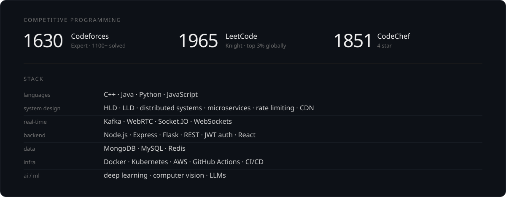

<a href="https://www.linkedin.com/in/meetaghara512">LinkedIn</a> · <a href="https://codeforces.com/profile/meet.aghara522">Codeforces</a> · <a href="https://leetcode.com/u/meet_aghara522">LeetCode</a> · Live demos: <a href="https://sharethings-web.onrender.com">ShareThings</a>, <a href="https://drivemyway-web.onrender.com">DriveMyWay</a>

